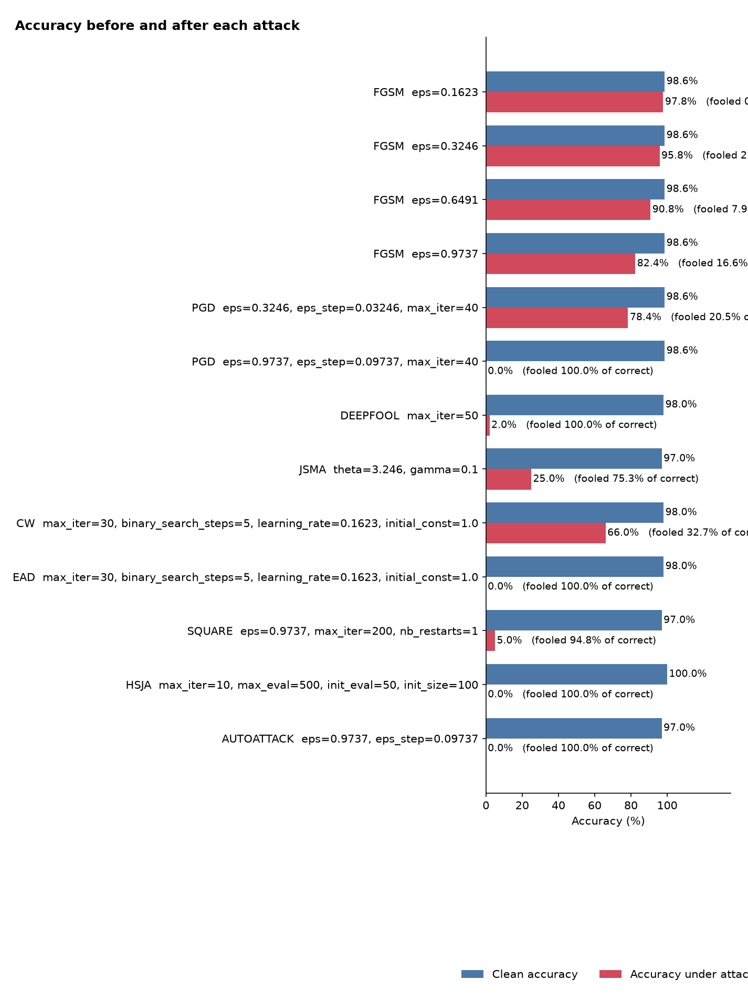
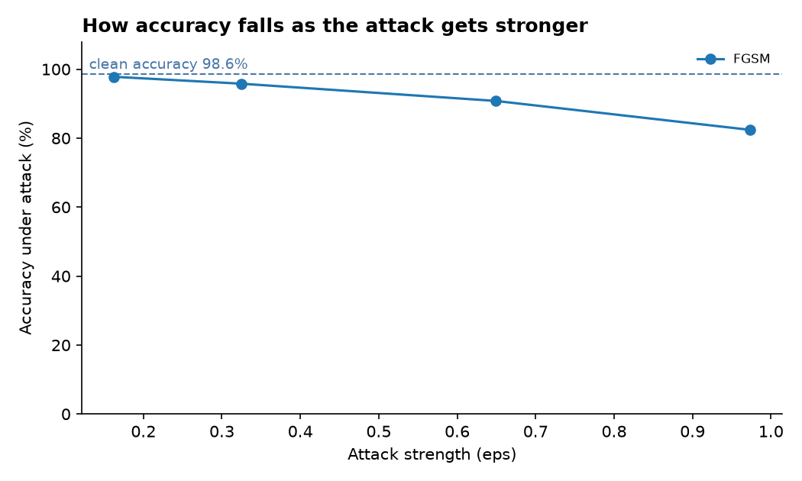

# MNIST — Adversarial Robustness Evaluation

**Run:** `2026-11-03 17:43:17 UTC`  
**Input shape:** `[1, 28, 28]`  
**Classes:** 10  
**Device:** cpu  
**Maximum test samples:** 500  
**Framework:** Adversarial Robustness Toolbox (ART) 1.20.1

## Results

| Attack | Samples | Adversarial accuracy | ASR | Execution |
|---|---:|---:|---:|---|
| FGSM | 500 | 97.80% | 0.81% | Completed |
| FGSM | 500 | 95.80% | 2.84% | Completed |
| FGSM | 500 | 90.80% | 7.91% | Completed |
| FGSM | 500 | 82.40% | 16.63% | Completed |
| PGD | 500 | 78.40% | 20.49% | Completed |
| PGD | 500 | 0.00% | 100.00% | Completed |
| DEEPFOOL | 200 | 2.00% | 100.00% | Completed |
| JSMA | 100 | 25.00% | 75.26% | Completed |
| CW | 50 | 66.00% | 32.65% | Completed |
| EAD | 50 | 0.00% | 100.00% | Completed |
| SQUARE | 100 | 5.00% | 94.85% | Completed |
| HSJA | 30 | 0.00% | 100.00% | Completed |
| AUTOATTACK | 100 | 0.00% | 100.00% | Completed |

## Interpretation

- FGSM was evaluated at four epsilon values. The reported ASR increased from 0.81% at ε=0.1623 to 16.63% at ε=0.9737.
- PGD at ε=0.3246 with 40 iterations reported 20.49% ASR over 500 samples.
- The highest-epsilon PGD, Square, and AutoAttack configurations used ε=0.9737, which is a large budget relative to typical small-pixel perturbation evaluations. Do not compare these figures directly with smaller-epsilon runs.
- Sample counts vary by attack (30–500); compare ASR only alongside its denominator and clean accuracy.
- DeepFool, JSMA, CW, EAD, and other attacks use different objective functions and constraints; their ASRs are not directly comparable as a single ranking.

## Visualizations

Selected adversarial examples are included as separate PNG files.

## Reproducibility and limitations

The report records the exact attack parameters, sample counts, runtime, clean accuracy, adversarial accuracy, and ASR. The target and dataset source paths have been redacted from the public JSON. The original report notes that ASR counts only samples correctly classified before the attack.
