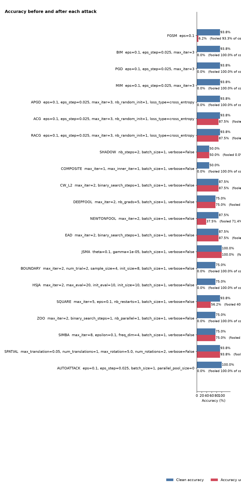

# ViT-Base-Patch16-224 — ImageNet Adversarial Robustness Evaluation

**Run:** `2026-11-06 18:49:05 UTC`  
**Input shape:** `[3, 224, 224]`  
**Classes:** 1000  
**Input range:** `[0, 1]`  
**Device:** cpu  
**Dataset cap:** 128 samples  
**Framework:** Adversarial Robustness Toolbox (ART) 1.20.1  
**Per-attack timeout:** 240 seconds

## Results

| Attack | Samples | Adversarial accuracy | ASR | Execution |
|---|---:|---:|---:|---|
| FGSM | 16 | 6.25% | 93.33% | Completed |
| BIM | 16 | 0.00% | 100.00% | Completed |
| PGD | 16 | 0.00% | 100.00% | Completed |
| MIM | 16 | 0.00% | 100.00% | Completed |
| APGD | 16 | 0.00% | 100.00% | Completed |
| ACG | 16 | 87.50% | 6.67% | Completed |
| RACG | 16 | 87.50% | 6.67% | Completed |
| VAT | — | — | — | TimeoutError |
| SHADOW | 2 | 50.00% | 0.00% | Completed |
| COMPOSITE | 2 | 0.00% | 100.00% | Completed |
| CW_L2 | 8 | 87.50% | 0.00% | Completed |
| CW_LINF | — | — | — | TimeoutError |
| CW_L0 | — | — | — | TimeoutError |
| DEEPFOOL | 4 | 75.00% | 0.00% | Completed |
| NEWTONFOOL | 8 | 37.50% | 71.43% | Completed |
| EAD | 8 | 87.50% | 0.00% | Completed |
| JSMA | 1 | 100.00% | 0.00% | Completed |
| WASSERSTEIN | — | — | — | ValueError |
| BOUNDARY | 4 | 0.00% | 100.00% | Completed |
| HSJA | 4 | 0.00% | 100.00% | Completed |
| SIGNOPT | — | — | — | TimeoutError |
| SQUARE | 16 | 56.25% | 40.00% | Completed |
| ZOO | 4 | 0.00% | 100.00% | Completed |
| SIMBA | 4 | 75.00% | 0.00% | Completed |
| PIXEL | — | — | — | TimeoutError |
| THRESHOLD | — | — | — | RuntimeError |
| SPATIAL | 16 | 93.75% | 0.00% | Completed |
| AUTOATTACK | 1 | 0.00% | 100.00% | Completed |

## Interpretation

- FGSM used ε=0.1 and reported 93.33% ASR on 16 samples. For `[0,1]` images, ε=0.1 is approximately 25.5/255, which is a relatively large perturbation budget for common robustness comparisons.
- BIM, PGD, MIM, and APGD reported 100% ASR, but each used only 16 samples and a short 3-iteration configuration. These are preliminary observations, not a general robustness score.
- Some black-box attacks used only 4 samples and very small iteration/query budgets. Their observed ASRs should not be generalized.
- CW-L2 and EAD used only 2 optimization iterations and 1 binary-search step; their 0% ASR results are under-configured and do not establish robustness.
- Several attacks timed out or failed because of runtime/dependency/numerical issues. These are execution outcomes, not successful robustness results.

## Execution issues

The following attacks did not produce usable adversarial-evaluation metrics in this run:

| Attack | Outcome |
|---|---|
| VAT | TimeoutError |
| CW_LINF | TimeoutError |
| CW_L0 | TimeoutError |
| WASSERSTEIN | ValueError |
| SIGNOPT | TimeoutError |
| PIXEL | TimeoutError |
| THRESHOLD | RuntimeError |

## Visualizations

Selected attack examples are included as PNG files.

## Reproducibility and limitations

The run used CPU execution and a maximum dataset cap of 128, but individual attacks evaluated different subsets. The report includes per-attack sample counts and parameters. Results are limited to this model artifact, preprocessing path, subset, and configuration.
